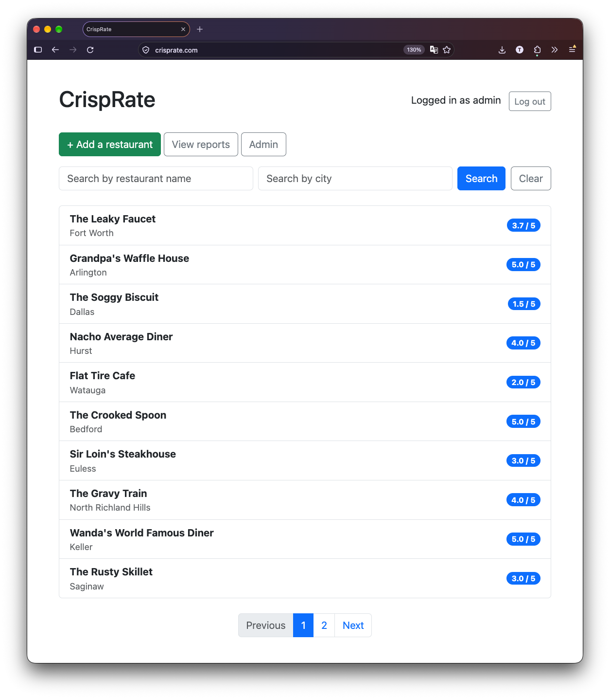
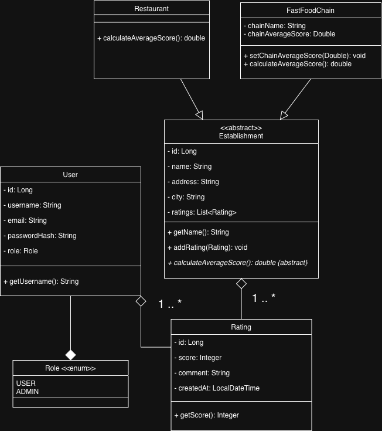

# CrispRate

Crowdsourced ratings for fountain drink carbonation. Find out which restaurants pour a crisp soda and which ones serve flat syrup water.

**Live:** [crisprate.com](https://crisprate.com)



## Features

- **Search** establishments by name or city with paginated results
- **Rate** carbonation on a 1–5 scale and edit or delete your own ratings
- **Restaurants vs. fast-food chains** and chains aggregate scores across locations
- **User accounts** with secure registration and login
- **Admin dashboard** for moderating establishments and ratings
- **Reports** with CSV export

## Tech Stack

| Layer | Technology |
|---|---|
| Backend | Java 21, Spring Boot, Spring Data JPA |
| Frontend | Thymeleaf (server-rendered) |
| Security | Spring Security, BCrypt password hashing, role-based access |
| Database | PostgreSQL (hosted on Supabase) |
| Testing | JUnit 5, Mockito |
| Deployment | Docker (multi-stage build) on Render, Cloudflare DNS |

## Architecture

Layered Spring Boot design: **controller → service → repository → entity**.

- `Establishment` is an abstract entity using JPA single-table inheritance, with `Restaurant` and `FastFoodChain` subclasses that each override `calculateAverageScore()` (polymorphism)
- Business rules (score validation, ownership checks) live in the service layer and are unit tested
- Admin routes (`/admin/**`) are restricted by role through Spring Security



## Deployment

- The app is packaged with a **multi-stage Dockerfile** (build with Maven, run on a slim Java 21 runtime)
- Render auto-deploys from `main` on every push
- Supabase hosts Postgres, reached through its IPv4 session pooler, with HikariCP tuned to a 5-connection pool for the free tier
- Cloudflare handles DNS for the custom domain
- Configuration comes entirely from environment variables, so no secrets are committed

## Running Locally

**Prerequisites:** Java 21, PostgreSQL

```bash
# Create the local database
createdb crisprate

# Run the app (tables are created automatically on first start)
mvn spring-boot:run
```

Then visit http://localhost:8080.

To use a different database, set these environment variables:

| Variable | Default |
|---|---|
| `DATABASE_URL` | `jdbc:postgresql://localhost:5432/crisprate` |
| `DATABASE_USERNAME` | `<your local user>` |
| `DATABASE_PASSWORD` | *(empty)* |

## Testing

```bash
mvn test
```

<14> unit tests cover the entity scoring logic and the service layer. Writing them caught a real bug: score bounds (1–5) weren't enforced when submitting or updating a rating.

## About

Built by Tyler Cave as a capstone project for the B.S. in Software Engineering at Western Governors University.
